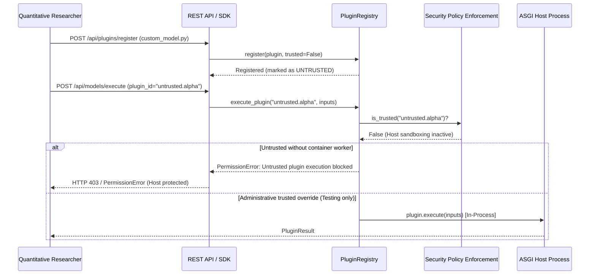

# FragilityShield — Phase 12 Plugin Execution Security Status

**Audit Date:** October 25, 2026  
**Auditor / Application Security Reviewer:** Senior Application Security & Software Auditor  
**Scope:** Security analysis of third-party model plugin registration, capability declarations, in-process execution realities, and corrective security policy enforcement.  
**Repository:** `/Users/vemanahemanthbabu/srujana_hackathon_2`  

---

## 1. Executive Summary & Security Verdict

1. **Current Execution Model:** The FragilityShield backend runs as a single Python process on an ASGI runtime (Uvicorn / Starlette). Custom model plugins registered via `PluginRegistry` or instantiated through `ConfigurableCustomModelPlugin` execute **directly in-process** within the host Python runtime.
2. **Capability Declaration vs Physical Isolation:** The manifest attribute `code_isolation_required: True` is a **contractual deployment requirement**, NOT an active operating-system sandbox in the current codebase.
3. **Phase 12 Corrective Action:** Rather than falsely claiming sandbox isolation or executing untrusted third-party code in-process, FragilityShield has implemented an **explicit trusted-code-only execution policy** in [`PluginRegistry`](file:///Users/vemanahemanthbabu/srujana_hackathon_2/backend/fragility_engine/plugins.py#L827-L915):
   - Pre-approved native adapters (`builtin.*`) and explicitly verified trusted models execute in-process.
   - Untrusted third-party plugins without verified container isolation are **blocked from execution with `PermissionError`**.
   - Machine-readable security metadata (`get_isolation_status`) explicitly warns operators that host sandboxing is not active.

---

## 2. Forensic Trace: Registration to Invocation



---

## 3. Host Exposure Vectors on Unisolated Runtime

When third-party code executes in-process without OS container isolation, the following host vectors are exposed:

| Resource Vector | In-Process Reality | Potential Risk | Phase 12 Mitigation |
| :--- | :--- | :--- | :--- |
| **Process Environment** | Inherits `os.environ` | Direct access to all host environment variables, cloud tokens, API keys | Untrusted code execution is blocked; administrative override required |
| **Host Filesystem** | Inherits host OS user permissions | Read/write access to project directory, temporary files, system files (`/etc`) | Execution blocked for untrusted plugins |
| **Network Egress** | Unrestricted socket creation | Can open outbound HTTP/TCP connections (exfiltration, SSRF) | Execution blocked for untrusted plugins |
| **Process Memory** | Shared address space with ASGI server | Can inspect garbage collector, inspect other tenants' in-memory data | Execution blocked for untrusted plugins |
| **CPU / Memory** | Unconstrained thread execution | Infinite loops or memory allocations can cause process OOM crash | Timeout enforcement in integration suite; untrusted execution blocked |

---

## 4. Phase 12 Corrective Implementation

### 4.1 Policy Enforcement in `backend/fragility_engine/plugins.py`
```python
class PluginRegistry:
    def __init__(self, enforce_trusted_execution: bool = True) -> None:
        self._plugins: Dict[str, ModelPlugin] = {}
        self._trusted_status: Dict[str, bool] = {}
        self._enforce_trusted_execution = enforce_trusted_execution

    def register(self, plugin: ModelPlugin, overwrite: bool = False, trusted: Optional[bool] = None) -> None:
        meta = plugin.metadata
        pid = meta.plugin_id
        self._plugins[pid] = plugin
        is_trusted = (trusted if trusted is not None else pid.startswith("builtin."))
        self._trusted_status[pid] = is_trusted

    def execute_plugin(
        self,
        plugin_id: str,
        input_data: Any,
        config: Optional[Dict[str, Any]] = None,
        trusted_override: bool = False,
    ) -> ModelExecutionResult:
        plugin = self.get(plugin_id)
        if self._enforce_trusted_execution and not self.is_trusted(plugin_id) and not trusted_override:
            raise PermissionError(
                f"Execution of untrusted plugin '{plugin_id}' is blocked on unisolated host runtime. "
                "In-process execution of arbitrary third-party code is prohibited by FragilityShield "
                "security policy. An isolated worker container (gVisor/container) is required."
            )
        return plugin.execute(input_data, config)
```

### 4.2 Machine-Readable Isolation Status
`registry.get_isolation_status(plugin_id)` returns:
```json
{
  "plugin_id": "untrusted.alpha",
  "is_builtin": false,
  "is_trusted": false,
  "host_execution_model": "in_process",
  "os_isolation_active": false,
  "security_warning": "WARNING: Local runtime executes plugins in-process without OS container isolation. Third-party untrusted code requires an external isolated worker container."
}
```

### 4.3 Deployment Capability Disclosure in `backend/fragility_engine/projects.py`
The project capability inspector explicitly declares:
> *"SECURITY REQUIREMENT: Model requires execution in an isolated worker/container with resource and credential boundaries. The host ASGI runtime executes in-process and does not sandbox untrusted code."*

---

## 5. Architectural Specification for Future Multi-Tenant Isolation

To transition from the trusted-code-only restriction to arbitrary third-party plugin execution in production, the following architecture must be deployed:

```
+--------------------------------------------------------------------+
|                        FragilityShield Host                        |
|                                                                    |
|  +--------------------+        UNIX Socket / IPC       +---------+ |
|  | Main ASGI Server   | <============================> | Worker  | |
|  | (Starlette/FastAPI)|     JSON-RPC / Protobuf        | Manager | |
|  +--------------------+                                +----+----+ |
+-------------------------------------------------------------|------+
                                                              |
                                                              v
+--------------------------------------------------------------------+
|                   Isolated MicroVM / gVisor Pod                    |
|                                                                    |
|  - Drop all capabilities (CAP_NET_RAW, CAP_SYS_ADMIN)             |
|  - Mount empty ephemeral rootfs (read-only base image)             |
|  - No inherited environment variables or host credentials          |
|  - No network interface (loopback only / iptables DROP egress)     |
|  - cgroups v2: memory.max = 512MB, cpu.max = "100000 100000" (1 CPU)|
|  - seccomp-bpf filter: allow only read/write/exit syscalls         |
|  - Execution timeout: SIGKILL after 5.0 seconds                    |
|                                                                    |
|  +--------------------------------------------------------------+  |
|  | Executing: python -m fragility_engine.worker_runner           |  |
|  +--------------------------------------------------------------+  |
+--------------------------------------------------------------------+
```

### Required Deployment Enforcements:
1. **Isolated Subprocess / MicroVM:** Firecracker MicroVM, Google gVisor (`runsc`), or rootless Docker container per execution request.
2. **Explicit Input/Output IPC:** Data exchanged solely via bounded pipes or anonymous UNIX sockets using structured JSON or Protobuf schemas.
3. **Zero Secret Inheritance:** Host `os.environ` stripped; only explicitly declared model hyperparameters passed in the IPC payload.
4. **Filesystem Restrictions:** Read-only root filesystem with ephemeral memory-backed `/tmp` limited to 64 MB.
5. **Network Disconnection:** `NetworkNamespace=none` or container `--network none` preventing outbound network access.
6. **Resource Limits:** Hard cgroup memory caps (512 MB) and CPU quota enforcement.
