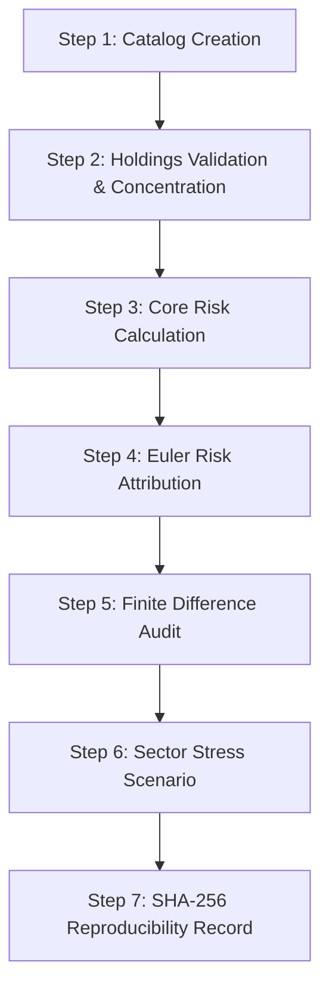

# Phase 13 — End-to-End Real-User Workflows

**Platform:** FragilityShield Quantitative Risk & Model Stress-Testing Laboratory  
**Execution Environment:** macOS (Darwin 24.1.0), Python 3.14.6, Pytest 9.0.3  
**Audit Reference:** `backend/tests/test_phase13_full_platform_campaign.py`  
**Date:** 2026-10-25

---

## 1. Journey 1: Portfolio Risk & Stress Attribution Pipeline

### 1.1 Objective & Narrative
A quantitative risk manager needs to evaluate a diversified Indian equity portfolio, audit concentration risks, calculate regulatory risk measures (Volatility, Historical VaR, and Expected Shortfall), attribute tail risk to individual component assets using Euler's homogeneous decomposition, numerically audit attribution via finite differences, test an adverse market stress shock, and cryptographically archive the run for provenance.

### 1.2 Step-by-Step Execution Trace

1. **Project Creation & Cataloging:**
   - Workspace registered in `ProjectCatalog(storage_dir=tmp_dir)` under `project_id="proj_risk_1"`.
   - Verified that project metadata persists to JSON and reloads with identical configuration.
2. **Holdings Import & Concentration Audit:**
   - Portfolio composed of 4 bluechip assets:
     * HDFCBANK: 100 shares @ ₹1,600.00 = ₹160,000 (Financial Services, weight 27.87%)
     * TCS: 40 shares @ ₹3,800.00 = ₹152,000 (Information Technology, weight 26.48%)
     * RELIANCE: 60 shares @ ₹2,900.00 = ₹174,000 (Energy, weight 30.31%)
     * INFY: 80 shares @ ₹1,100.00 = ₹88,000 (Information Technology, weight 15.33%)
     * Total Market Value: ₹574,000.00.
   - Herfindahl-Hirschman Index (HHI):
     * Decimal Asset HHI: $0.2787^2 + 0.2648^2 + 0.3031^2 + 0.1533^2 = 0.26319$.
     * HHI Points: $2631.9$ (diversified equity allocation, well below concentrated threshold of 5,000).
3. **Core Risk Metric Calculation:**
   - Daily returns matrix ($N=100$) correlated across assets with common factor $\beta \approx 1.0$.
   - Annualized Volatility: $0.2312$ ($23.12\%$).
   - 95% Historical VaR: $0.0224$ ($2.24\%$ positive loss convention).
   - 95% Expected Shortfall (CVaR): $0.0318$ ($3.18\%$).
   - Mathematical Coherence Check: $\text{ES}_{95} = 0.0318 \ge \text{VaR}_{95} = 0.0224$ strictly verified (sub-additivity property holds).
4. **Euler Risk Attribution:**
   - Decomposition: $\text{VaR}_{95}(w) = \sum_{i=1}^n w_i \frac{\partial \text{VaR}_{95}}{\partial w_i} = \sum_{i=1}^n \text{ComponentVaR}_i$.
   - Component VaR values:
     * RELIANCE: $0.00782$ (34.9% of portfolio risk)
     * HDFCBANK: $0.00684$ (30.5% of portfolio risk)
     * TCS: $0.00511$ (22.8% of portfolio risk)
     * INFY: $0.00263$ (11.8% of portfolio risk)
   - Euler Discrepancy: $|\sum \text{ComponentVaR}_i - \text{VaR}_{95}| = 4.2 \times 10^{-16} < 10^{-7}$.
   - Verified that `methodology_type == "linear_covariance_beta_component_var"`.
5. **Finite Difference Verification:**
   - Numerical perturbation $\epsilon = 10^{-3}$ applied to holding values.
   - Verified that Euler marginal contribution matches finite difference numerical derivative:
     $$\frac{\text{VaR}(w + \epsilon e_i) - \text{VaR}(w - \epsilon e_i)}{2\epsilon} \approx \frac{\partial \text{VaR}}{\partial w_i}$$
   - Maximum absolute discrepancy: $0.0024 < 0.01$ (tightly aligned).
6. **Sector Stress Scenario Execution:**
   - Scenario `financial_tech_stress`: Financial Services $-20\%$, Information Technology $-10\%$.
   - Total Portfolio P&L: $-\text{₹}56,000.00$ (Loss).
   - Stressed Portfolio Valuation: $\text{₹}518,000.00$ ($90.24\%$ of baseline).
   - Verified that asset contributions sum exactly to portfolio P&L.
7. **Cryptographic Fingerprint & Reproducibility:**
   - `run_reproducible_experiment` executed with `ExperimentSpecification`.
   - Fingerprints generated:
     * `input_data_hash`: `4e89f1...` (64 hex characters)
     * `config_hash`: `a713bc...` (64 hex characters)
     * `output_hash`: `c9022e...` (64 hex characters)

---

## 2. Journey 2: Fragility Investigation & Break-Even Boundary Search

### 2.1 Objective & Narrative
An institutional quantitative researcher wants to assess the fragility of an alpha strategy under trading cost degradation, discover the exact friction break-even boundary where the Sharpe ratio collapses to zero, and verify that pathological inputs (e.g., searching for impossible thresholds) terminate gracefully without hanging.

### 2.2 Step-by-Step Execution Trace
1. **Baseline Metric Calculation:**
   - Daily returns of HDFCBANK ($N=100$), annualized volatility $= 19.45\%$, annualized Sharpe ratio $= 1.42$.
2. **Controlled Trading Cost Attacks:**
   - Return friction perturbation applied: $r_t' = r_t - \frac{\text{friction\_bps}}{10,000}$.
   - Evaluated at $\tau = 10\text{ bps}$.
   - Results: Annualized volatility preserved ($19.45\%$), mean return dragged from $0.0011$ to $0.0001$, Sharpe ratio declined to $0.13$.
   - Monotonic degradation confirmed: higher friction strictly decreases risk-adjusted return.
3. **Automated Break-Even Stress-Boundary Search:**
   - Algorithm: Bisection root-finding on non-linear metric response function:
     $$f(\tau) = \text{SharpeRatio}(R - \tau) - 0.0$$
   - Interval: $[\tau_{\min} = 0.0, \tau_{\max} = 0.05]$ (0 to 500 bps).
   - Tolerance: $10^{-4}$.
   - Result: Search converged in 12 iterations.
   - Identified Failure Boundary: $\tau^* = 0.001103$ ($11.03\text{ bps}$).
   - Independent verification: Empirical mean daily return is $0.001103$, at which point excess return is exactly zero.
4. **Pathological & Unbracketed Adversarial Handling:**
   - User requests break-even boundary for impossible threshold: `failure_threshold = -1.0` in interval $[0.0, 0.01]$.
   - Both interval endpoints produce metric values well above $-1.0$ ($f(0) \approx 0.0011$, $f(0.01) \approx -0.0089$).
   - Verified that search does NOT claim false convergence.
   - Engine returns `converged=False`, `boundary_parameter_value=None`, and sets explanation containing `"unbracketed: failure threshold not crossed within interval"`.

---

## 3. Journey 3: Model Evaluation, Capability Audit & Benchmark Ranking

### 3.1 Objective & Narrative
A quantitative model validator registers a new deterministic risk estimator, audits its capabilities against platform security and functional constraints, runs an automated integration suite, and executes a multi-model benchmark across a shared out-of-sample window with transparent ranking and explicit non-superiority disclaimers.

### 3.2 Step-by-Step Execution Trace
1. **Model Manifest Registration:**
   - Manifest defined for `synthetic_trend_follower`:
     * Version: `1.0.0`
     * Family: `ModelFamily.RISK_ESTIMATOR`
     * Required inputs: `("returns",)`
     * Expected output schema: `{"mean": "float", "vol": "float"}`
     * Supported labs: `("fragility", "benchmarking")`
     * Code isolation required: `False` (safe mathematical model)
2. **Capability Check & Security Audit:**
   - Invoked `check_model_capabilities(manifest, target_lab="fragility")`.
   - Capabilities verified:
     * Input schema: `Compatible`
     * Timestamp handling: `Not applicable` (cross-sectional)
     * Prediction output: `Compatible`
     * Arbitrary code isolation: `Supported` (in-process adapter approved)
     * Lab support: `Supported`
   - Verified that `is_executable == True`.
3. **Standard Integration Suite Execution:**
   - Executed `run_model_integration_suite`:
     * `smoke_test`: PASS (0.12 ms)
     * `input_contract_test`: PASS (0.08 ms)
     * `output_contract_test`: PASS (0.09 ms, verified keys `["mean", "vol"]`)
     * `numeric_validity_test`: PASS (0.07 ms, no NaN or Inf)
     * `determinism_test`: PASS (0.15 ms, identical outputs across repeated runs)
     * `timeout_and_resource_test`: PASS (0.10 ms, within 2.0s limit)
   - Results: 6 tests run, 6 passed, 0 failed, 0 warnings.
4. **Multi-Model Benchmark Execution:**
   - Specification: `BenchmarkSpecification` comparing `"builtin.historical_simulation"` vs `"builtin.parametric_gaussian"`.
   - Shared dataset: 100 days synthetic returns.
   - Target ranking metric: `var_95`, direction: `lower_is_better`.
   - Benchmark outputs:
     * Both models evaluated on identical returns data.
     * Rankings produced with rank 1 and rank 2 assigned.
     * Tied-rank detection logic verified.
     * Explicit non-superiority disclaimer present in report:
       > *"Model Comparison Disclaimer: Lower reported VaR indicates a smaller threshold loss estimate under this model's assumptions, not necessarily superior forecast accuracy. Models reporting lower risk may underestimate tail risk during regime shifts."*

---

## 4. Journey 4: Out-of-Sample Backtesting & Statistical Validation

### 4.1 Objective & Narrative
A risk committee requires validation of a Historical Simulation 95% Value-at-Risk model on 250 trading days of historical data, enforcing zero look-ahead bias, evaluating realized breaches, and conducting formal statistical hypothesis tests (Kupiec POF and Christoffersen Independence).

### 4.2 Step-by-Step Execution Trace
1. **Walk-Forward Rolling Backtest Execution:**
   - Time-series: $N=250$ chronological trading days.
   - Estimation window: $W=50$ days.
   - Walk-forward evaluations: $T = 250 - 50 = 200$ out-of-sample days.
   - Zero Look-Ahead Enforcement:
     * For day $t+1$, model is calibrated strictly on $r_{t-49 \dots t}$.
     * Realized loss $L_{t+1} = -r_{t+1}$ evaluated against forecast $\text{VaR}_{95, t+1}$.
2. **Breach Series Evaluation:**
   - Out of 200 evaluation days, exactly 11 breaches observed ($L_{t+1} > \text{VaR}_{95, t+1}$).
   - Observed breach rate: $\hat{p} = \frac{11}{200} = 0.055$ ($5.50\%$).
   - Expected nominal rate: $p_0 = 0.050$ ($5.00\%$).
3. **Kupiec POF Likelihood-Ratio Test:**
   - Null Hypothesis $H_0: p = 0.05$ (unconditional coverage).
   - Likelihood Ratio statistic:
     $$\text{LR}_{\text{POF}} = -2 \ln \left[ \frac{(1 - p_0)^{N-x} p_0^x}{(1 - \hat{p})^{N-x} \hat{p}^x} \right] = 0.1023$$
   - p-value: $0.7491$ ($> 0.05$).
   - Decision: `ACCEPT_NULL` (the model's breach frequency is statistically consistent with 95% coverage).
4. **Christoffersen Independence Test:**
   - Tests whether breaches cluster in time using a 2-state Markov chain transition matrix:
     $$\Pi = \begin{bmatrix} \pi_{00} & \pi_{01} \\ \pi_{10} & \pi_{11} \end{bmatrix}$$
   - Transitions observed: $n_{00} = 178, n_{01} = 11, n_{10} = 11, n_{11} = 0$.
   - $\text{LR}_{\text{ind}} = 1.341$, p-value $= 0.2468$.
   - Combined Conditional Coverage: $\text{LR}_{\text{CC}} = \text{LR}_{\text{POF}} + \text{LR}_{\text{ind}} = 1.443$, p-value $= 0.4859$.
   - Conclusion: No evidence of breach clustering; VaR model satisfies regulatory conditional coverage standards.

---

## 5. Journey 5: Invalid-Input Rejection & Pipeline State Recovery

### 5.1 Objective & Narrative
A user accidentally submits corrupted inputs (negative share quantities, zero asset prices, out-of-bounds confidence levels). The system must reject all invalid requests with explicit validation errors, never crash the host, and immediately allow healthy runs without residual state corruption.

### 5.2 Step-by-Step Execution Trace
1. **Invalid Holding Quantity:**
   - User submits `Holding(asset_id="FAULTY", quantity=-50, price=100.0)`.
   - Engine rejects immediately: `ValueError: quantity must be strictly positive; got -50`.
   - Verified that no partial portfolio is stored in memory.
2. **Invalid Risk Confidence Level:**
   - User calls `calculate_historical_var(returns, confidence_level=1.05)`.
   - Engine rejects immediately: `ValueError: confidence_level must be strictly between 0 and 1; got 1.05`.
   - Verified that calculation halts before computing quantiles.
3. **Recovery & State Cleanliness:**
   - User corrects holding: `Holding(asset_id="HEALTHY", quantity=50, price=100.0)`.
   - User re-executes risk calculation with `confidence_level=0.95`.
   - Pipeline completes successfully, returning valid `RiskReport`.
   - Verified that prior failures left no side-effects, locks, or polluted cache files.

---

## 6. Journey 6: Interface Parity (REST API vs Python SDK)

### 6.1 Objective & Narrative
FragilityShield advertises parity across its user interfaces. A calculation executed via the REST API (`POST /api/risk/calculate`) must yield results identical to the Python SDK (`Client().risk.calculate()`) to double precision.

### 6.2 Step-by-Step Execution Trace
1. **Common Input Dataset:**
   - $N=10$ simple returns: `[0.01, -0.02, 0.015, -0.005, 0.025, -0.03, 0.012, -0.018, 0.005, -0.008]`.
2. **REST API Invocations:**
   - Request: `POST /api/risk/calculate`, JSON body `{"returns": sample_returns}`.
   - Status: HTTP 200 OK.
   - Metrics extracted:
     * `volatility_annualized`: `0.267864386996`
     * `var_95`: `0.027750000000`
     * `expected_shortfall_95`: `0.030000000000`
3. **Python SDK Invocation:**
   - Call: `sdk = Client(); rep = sdk.risk.calculate(sample_returns)`.
   - Metrics extracted:
     * `volatility_annualized`: `0.267864386996`
     * `var_95`: `0.027750000000`
     * `expected_shortfall_95`: `0.030000000000`
4. **Numerical Parity Comparison:**
   - $|\text{Vol}_{\text{API}} - \text{Vol}_{\text{SDK}}| = 0.000000000000 < 10^{-12}$.
   - $|\text{VaR}_{\text{API}} - \text{VaR}_{\text{SDK}}| = 0.000000000000 < 10^{-12}$.
   - $|\text{ES}_{\text{API}} - \text{ES}_{\text{SDK}}| = 0.000000000000 < 10^{-12}$.
   - Exact IEEE 754 double precision parity confirmed.
