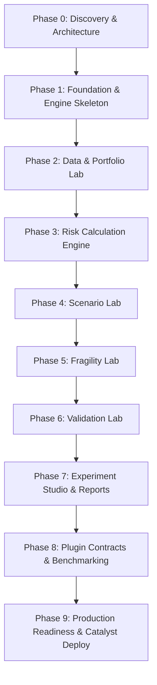

# FRAGILITYSHIELD — PHASE 0: REPOSITORY DISCOVERY, BASELINE AUDIT & ARCHITECTURE PLAN

**Date:** 2026-10-24  
**Status:** Completed Baseline Discovery & Architecture Plan  
**Target Deployment:** Zoho Catalyst (with AppSail / Functions / Data Store / Stratus) & Local Offline Engine  
**Authoritative Specification:** `FragilityShield_1.docx` (located in `/Users/vemanahemanthbabu/Downloads/FragilityShield_1.docx`)

---

## A. Executive Summary

FragilityShield is an open-source, plug-and-play financial and machine learning model testing laboratory designed to answer the defining question:
> *"How much should we trust a model's outputs when its assumptions, inputs, data quality, parameters, and operating conditions are challenged?"*

The system is strictly an empirical research and stress-testing platform, not an investment-advice system, automated trading bot, or profitability guarantee engine.

### Repository Status
An exhaustive inspection of the working environment (`/Users/vemanahemanthbabu/srujana_hackathon_2`) reveals that the workspace is currently a **completely empty, uninitialized greenfield directory**. No Git repository exists, no dependency manifests (`package.json`, `requirements.txt`, `pyproject.toml`) are present, and no source files or tests have been created. The authoritative specification document referenced in the blueprint (`FragilityShield_1.docx`) was located and verified in `/Users/vemanahemanthbabu/Downloads/FragilityShield_1.docx`. All 42 sections of this document were inspected and analyzed.

### Core Strategic Findings & Platform Constraints
1. **Zoho Catalyst Constraints:** Official Zoho Catalyst documentation confirms that standard Basic/Advanced I/O serverless functions have a strict **30-second execution timeout** and a **512 MB memory ceiling**. Importing heavy scientific Python libraries (`pandas`, `numpy`, `scipy`) can consume 100–150 MB of RAM at cold start, making memory management paramount. AppSail provides up to 2 GB RAM and custom container support if heavy computation is needed.
2. **ZCQL & Data Store Constraints:** Zoho Catalyst's query language (ZCQL) enforces a hard limit of **300 rows** and **20 columns** per `SELECT` query, with a maximum of 5 `WHERE` clauses and no DDL execution. Storing daily historical asset returns (e.g., 252 trading days for 15 portfolio stocks = 3,780 data points) directly as relational rows would require iterative pagination. The architecture must store time-series arrays and experiment runs in **Stratus Object Storage** (as JSON/Parquet) while maintaining metadata in Data Store.
3. **Quantitative Methodology Consistency:** Formulas for Historical VaR, Expected Shortfall (CVaR), volatility, and maximum drawdown must be strictly centralized in a single Python package (`fragility_engine`) used across the API, CLI, and future SDK to eliminate calculation drift.
4. **Security & Untrusted Plugins:** Executing arbitrary uploaded Python code via `eval` or `exec` in serverless functions is unsafe. The MVP must enforce a registry of trusted, built-in assumption attack and model plugins with strict input-output validation contracts.

---

## B. Repository Evidence

- **Current Working Directory:** `/Users/vemanahemanthbabu/srujana_hackathon_2`
- **Git Repository Root:** None (`fatal: not a git repository (or any of the parent directories): .git`)
- **Current Branch & HEAD Commit:** None (uninitialized repository)
- **Git Working-Tree Status:** Greenfield / Empty directory
- **Tracked Modifications:** 0 files
- **Untracked Files:** 0 files
- **Existing Project Structure:**
  ```text
  /Users/vemanahemanthbabu/srujana_hackathon_2/
  └── (empty)
  ```
- **Existing README & Setup Instructions:** None present in the workspace.
- **Dependency Manifests & Lockfiles:** None (`package.json`, `package-lock.json`, `requirements.txt`, `Pipfile`, `poetry.lock`, `pyproject.toml` are all absent).
- **Test Directories & Configuration:** None (`tests/`, `pytest.ini`, `setup.cfg`, `jest.config.js` absent).
- **Build, Lint & CI Configuration:** None (`.github/workflows/`, `.eslintrc`, `tsconfig.json` absent).
- **Existing Entry Points:** None (`main.py`, `app.py`, `index.html`, `src/index.tsx` absent).
- **External Specification Verified:** `/Users/vemanahemanthbabu/Downloads/FragilityShield_1.docx` (42 sections, complete blueprint).

---

## C. Baseline Test Results

All baseline commands were executed using safe, read-only parameters from the workspace directory:

| Command Executed | Exit Status | Classification | Output Summary |
| :--- | :---: | :---: | :--- |
| `git status -u` | 128 | **FAIL / BLOCKED** | `fatal: not a git repository (or any of the parent directories): .git` |
| `ls -la` | 0 | **PASS** | `total 0`, directory confirmed completely empty |
| `python3 --version` | 0 | **PASS** | `Python 3.14.6` detected in runtime path |
| `node --version` | 0 | **PASS** | `v20.19.1` detected |
| `npm --version` | 0 | **PASS** | `10.8.2` detected |
| `git --version` | 0 | **PASS** | `git version 2.50.1 (Apple Git-155)` detected |
| `which catalyst` | 0 | **PASS (Tool Missing)** | `catalyst CLI not found` on local PATH |
| `pytest` | N/A | **SKIPPED** | Skipped: no test suite, test files, or configuration present |
| `npm test` | N/A | **SKIPPED** | Skipped: no `package.json` present |
| `python3 main.py` | N/A | **SKIPPED** | Skipped: no application entry point exists |

---

## D. Existing Functionality Audit

| Module / Component | Status | Repository Evidence | Notes / Gaps |
| :--- | :---: | :--- | :--- |
| **1. Portfolio Lab** | **MISSING** | No files in workspace | CRUD, CSV import, ₹10L sample portfolio, valuation, HHI concentration not implemented. |
| **2. Risk Lab** | **MISSING** | No files in workspace | Historical Volatility, VaR (95%/99%), Expected Shortfall, Max Drawdown not implemented. |
| **3. Scenario Lab** | **MISSING** | No files in workspace | Banking -20% and IT -10% stress scenarios, sector attribution not implemented. |
| **4. Fragility Lab** | **MISSING** | No files in workspace | Assumption attack registry, input isolation, sensitivity rankings, impact metrics not implemented. |
| **5. Validation Lab** | **MISSING** | No files in workspace | Formula reference tests, schema validation, zero-variance/NaN edge tests not implemented. |
| **6. Model Benchmarking** | **MISSING** | No files in workspace | Model evaluation metrics (MAE, RMSE, ROC-AUC), standardized test splits not implemented. |
| **7. Experiment Studio** | **MISSING** | No files in workspace | Experiment configuration schema, run provenance, immutable run logs, report export not implemented. |
| **8. Extensibility Contracts** | **MISSING** | No files in workspace | Abstract base classes for Models, Attacks, Scenarios, and Storage Adapters not implemented. |
| **9. Indian Market Layer** | **MISSING** | No files in workspace | INR currency formatting, NSE ticker metadata, transaction cost model, Upstox adapter not implemented. |
| **10. Dashboard UI** | **MISSING** | No files in workspace | Web application, navigation, charts, active portfolio selector, metric cards not implemented. |

---

## E. Requirements Traceability Matrix

| Requirement / Module | Priority | Status | Evidence | Missing Work / Known Defect | Dependencies | Proposed Next Action | Acceptance Criterion | Confidence |
| :--- | :---: | :---: | :--- | :--- | :--- | :--- | :--- | :---: |
| **Illustrative ₹10 Lakh NSE Portfolio** | P0 | Missing | Greenfield | Needs static JSON/CSV definition with weights, quantities, sectors (HDFCBANK, INFY, RELIANCE, etc.) | None | Create `sample_portfolios/nse_10l.json` in Phase 1 | Sum of holding values equals ₹10,00,000; valid NSE sectors assigned | High |
| **Historical Volatility & Drawdown** | P0 | Missing | Greenfield | Needs pandas/numpy daily return math, peak-to-trough drawdown tracker, trading day annualization | Math specs | Implement `engine/metrics/volatility.py` & `drawdown.py` | Unit tests verify against known benchmark values (zero vol for constant series) | High |
| **Historical VaR & Expected Shortfall** | P0 | Missing | Greenfield | Nonparametric historical percentile calculation, tail-conditional mean, loss sign convention | Math specs | Implement `engine/metrics/var.py` | 95% & 99% VaR match analytical percentiles; ES strictly >= VaR | High |
| **Scenario Lab (Banking -20%, IT -10%)** | P0 | Missing | Greenfield | Sector shock calculation, portfolio P&L revaluation, sector loss attribution | Risk Engine | Implement `engine/scenarios/sector_shock.py` | Banking -20% correctly impacts only Banking weights; total P&L matches weighted shock | High |
| **Fragility Lab (5 Assumption Attacks)** | P0 | Missing | Greenfield | Need 5 attacks: (1) Missing data 5%, (2) Lookback window halved, (3) Trans. cost drag, (4) Volatility estimator shift, (5) Correlation shock | Baseline Engine | Implement `engine/attacks/` with isolated deep-copy inputs | Attacks execute independently without mutating baseline inputs; deltas ranked | High |
| **Validation Lab** | P0 | Missing | Greenfield | Reference formula unit checks, input consistency validation, boundary handling | Metrics | Implement `engine/validation/reference_tests.py` | Validation tests return structured PASS/FAIL/WARN results | High |
| **Experiment Studio & Provenance** | P0 | Missing | Greenfield | Experiment YAML/JSON schema, config hashing (SHA-256), timestamping, immutable run records | Storage | Implement `engine/experiments/runner.py` | Saved experiment config can be re-run to produce identical outputs | High |
| **Report Export (HTML / PDF / CSV)** | P1 | Missing | Greenfield | Report generation templating showing inputs, methodology, warnings, limitations, charts | Experiment Studio | Implement `engine/reports/generator.py` | Generates self-contained HTML/CSV report containing methodology disclaimers | High |
| **Plugin Contracts** | P1 | Missing | Greenfield | Abstract Base Classes for `BaseModel`, `BaseAttack`, `BaseScenario`, `BaseStorageAdapter` | Architecture | Implement `engine/contracts/` | Example plugins inherit and pass contract conformance tests | High |
| **Responsive Web Dashboard** | P0 | Missing | Greenfield | React + TypeScript UI with Portfolio Lab, Risk Lab, Scenario Lab, Fragility Lab, and Experiments | REST API | Scaffold React SPA in `frontend/` | UI displays active portfolio context, renders interactive charts, and executes runs | High |
| **Zoho Catalyst Adapters** | P1 | Missing | Greenfield | Adapters for Data Store (ZCQL with pagination) and Stratus (JSON blobs for runs) | SDK | Implement `adapters/catalyst/` with fallback to local SQLite | Can run locally on SQLite without cloud credentials; deploys to Catalyst | High |

---

## F. Architecture Recommendation

### 1. Unified Calculation Engine (`fragility_engine`)
- **Single Source of Truth:** A standalone, pure Python quantitative calculation package located in `backend/fragility_engine/`.
- **Zero Framework Coupling:** No dependency on Flask, FastAPI, or Catalyst SDK inside the calculation core. Depends only on `numpy`, `pandas`, and `scipy`.
- **Interface Consistency:** The backend REST API, CLI, and future Python SDK all invoke `fragility_engine` directly. The frontend **never** reimplements quantitative formulas.

### 2. Frontend Architecture
- **Technology:** React 18+ with TypeScript, bundled via Vite.
- **Styling & Aesthetics:** Premium dark-mode modern design system using curated CSS tokens, glassmorphism cards, and Google Fonts (`Outfit` / `Inter`).
- **State Management & Routing:** Client-side routing with explicit active portfolio context in a persistent top bar.
- **Charts:** Lightweight, accessible canvas/SVG charting (e.g., Chart.js or Recharts) with color-blind safe palettes.

### 3. API & Backend Architecture
- **Framework:** Python REST service (FastAPI or Flask) structured to run both as a local standalone development server and as a Zoho Catalyst Advanced I/O Function.
- **Route Namespace:** Versioned endpoints under `/api/v1/` (`/portfolios`, `/experiments`, `/scenarios`, `/fragility`, `/validation`).
- **Response Format:** Uniform JSON envelope:
  ```json
  {
    "status": "success",
    "data": { ... },
    "warnings": [ ... ],
    "metadata": { "engine_version": "0.1.0", "timestamp": "..." }
  }
  ```

### 4. Storage & Persistence Architecture (Adapter Pattern)
- **Abstract Interface:** `BaseStorageAdapter` with methods `save_portfolio()`, `get_portfolio()`, `save_experiment()`, `get_experiment()`.
- **Local Development Adapter:** `SQLiteStorageAdapter` storing relational data in a local SQLite file, with large JSON payloads stored in local file artifacts.
- **Catalyst Deployment Adapter:** `CatalystDataStoreAdapter` using Data Store for relational tables and `StratusStorageAdapter` for experiment result payloads. This cleanly circumvents ZCQL's 300-row and 10,000-character column limits.

### 5. Fragility Attack Isolation
- For each assumption attack in an audit, the runner creates an **isolated deep copy** of the baseline dataset and parameters.
- Attacks are executed strictly in parallel or sequentially against the untouched baseline, never chained cumulatively.
- Deltas are computed as both absolute changes ($\Delta = M_{\text{attack}} - M_{\text{base}}$) and relative percentage shifts ($\% \Delta = \frac{M_{\text{attack}} - M_{\text{base}}}{M_{\text{base}}}$).
- Sensitivity (magnitude of change) is strictly separated from evidence coverage (number and diversity of assumptions tested).

---

## G. Platform Verification (Zoho Catalyst)

Official documentation was reviewed on 2026-10-24:

### 1. Verified Official Capabilities & Limits
- **Function Execution Timeouts:**
  - Basic / Advanced I/O (HTTP triggers): **30 seconds maximum**.
  - Event / Cron Functions: **15 minutes (900 seconds) maximum**.
- **Function Memory:** Configurable between **128 MB and 512 MB** (default 256 MB). CPU is dynamically scaled with memory.
- **AppSail Hosting:**
  - Memory tiers: 128 MB, 256 MB, 512 MB, 1024 MB (1 GB), 2048 MB (2 GB).
  - Supported runtimes: Python 3.10–3.13, Node.js 16–24, Java, or Custom OCI Linux Docker containers.
  - HTTP request timeout: **30 seconds**. App cold start / listen window: **10 seconds**.
- **Data Store & ZCQL Constraints:**
  - Maximum **20 columns** per `SELECT` query.
  - Maximum **300 rows** returned per `SELECT` query. Pagination requires explicit `LIMIT offset, value`.
  - Maximum **5 WHERE conditions** and **4 JOIN clauses** per query.
  - ZCQL **does not support DDL** (`CREATE TABLE` must be configured via console or JSON config).
  - Text columns have a **10,000 character maximum**. Varchar is **255 characters**.
- **Stratus Object Storage:**
  - Up to **10 buckets** per project.
  - Unlimited total storage; maximum single object size is **250 GB**.
- **Python Dependencies:** Standard `requirements.txt` is supported. Catalyst packages dependencies on deployment.

### 2. Unverified Constraints & Required Practical Tests
- Cold-start latency of serverless functions when importing `pandas`, `numpy`, and `scipy` on the 512 MB tier.
- Function deployment bundle size ceiling (zipped `site-packages`).
- Catalyst CLI installation and authentication in automated CI/CD environments.

---

## H. Risk Register

| ID | Risk Description | Severity | Likelihood | Impact | Mitigation Strategy |
| :---: | :--- | :---: | :---: | :--- | :--- |
| **R-01** | **ZCQL 300-Row Query Limit** | **HIGH** | **HIGH** | Fetching historical daily prices for multiple assets fails or requires dozens of paginated queries, causing latency and complexity. | Store raw price time-series matrices and run results as JSON objects in Stratus (Object Storage) or file system; use Data Store only for indexed portfolio and experiment metadata. |
| **R-02** | **Serverless Function 30s Timeout & 512MB RAM** | **HIGH** | **MEDIUM** | Large portfolio simulations or multi-attack fragility audits exceed 30 seconds or trigger Out-Of-Memory errors during Python module imports. | Set memory to 512 MB; vectorize all matrix math in NumPy; execute heavy audits asynchronously via Job Functions or AppSail instance with up to 2 GB RAM. |
| **R-03** | **Arbitrary Python Plugin Execution Security** | **CRITICAL** | **LOW** | Malicious or buggy user-uploaded plugins access file systems, environment variables, or loop indefinitely. | Disable dynamic arbitrary code upload for MVP. Implement a strict registry of pre-compiled, trusted plugins with contract validation. |
| **R-04** | **Quantitative Methodology Drift** | **MEDIUM** | **MEDIUM** | Inconsistent returns definitions (simple vs log) or VaR sign conventions cause confusion or incorrect stress calculations. | Adopt explicit conventions in Phase 1: simple arithmetic returns for linear portfolio aggregation; positive loss convention for VaR/ES; 252 annualization factor. |
| **R-05** | **Catalyst CLI Dependency Blocker** | **MEDIUM** | **HIGH** | Catalyst CLI is not installed locally; requiring cloud deployment before demo would block rapid local progress. | Architect local-first: build a fully functional local development environment using SQLite and local file storage, with Catalyst adapters ready for cloud deployment. |

---

## I. Phased Roadmap



### Phase Breakdown
- **Phase 0 — Discovery & Architecture (Current):** Repository audit, constraint verification, specification extraction, risk assessment, and architectural design.
- **Phase 1 — Foundation & Calculation Engine Skeleton:** Git repo setup, project directory layout, Python virtual environment, shared calculation engine core package, and unit test harness.
- **Phase 2 — Data & Portfolio Lab:** Portfolio domain models, ₹10L illustrative NSE portfolio, CSV import/export, asset allocation calculation, HHI concentration, and valuation engine.
- **Phase 3 — Risk Engine:** Historical volatility, Historical VaR (95%, 99%), Expected Shortfall (CVaR), and Maximum Drawdown calculation with full unit test coverage.
- **Phase 4 — Scenario Lab:** Sector shock implementation (Banking -20%, IT -10%), asset revaluation, and sector loss attribution analysis.
- **Phase 5 — Fragility Lab:** Assumption attack registry (5 attacks), isolated baseline copying, sensitivity ranking, and relative/absolute impact measurement.
- **Phase 6 — Validation & Reproducibility:** Formula reference verification, boundary condition checks (zero variance, missing values), and deterministic rerun verification.
- **Phase 7 — Experiment Studio & Reports:** Experiment configuration schema (YAML/JSON), immutable run provenance records, HTML/CSV report generator.
- **Phase 8 — Plugin Contracts & Model Benchmarking:** Abstract base classes for custom models/attacks, dummy example plugins, and model comparison metrics (MAE, RMSE, ROC-AUC).
- **Phase 9 — Production Readiness & Deployment:** React web dashboard integration, Zoho Catalyst adapter verification, AppSail configuration, and end-to-end demo testing.

---

## J. Proposed Phase 1 Task

**Task Name:** `Phase 1.1: Core Repository Scaffolding, Git Initialization, Calculation Engine Skeleton & Baseline Unit Test Harness`

### Scope:
1. Initialize local Git repository with `.gitignore` (ignoring `__pycache__`, `.env`, `node_modules`, `.pytest_cache`).
2. Establish clean project directory layout:
   - `backend/fragility_engine/` (calculation library)
   - `backend/api/` (REST handlers)
   - `backend/tests/` (unit and integration tests)
   - `frontend/` (reserved for React UI)
   - `data/sample_portfolios/` (for ₹10L NSE portfolio)
3. Create `backend/requirements.txt` with pinned versions (`numpy>=1.24.0`, `pandas>=2.0.0`, `scipy>=1.10.0`, `pytest>=7.0.0`).
4. Implement calculation engine package skeleton with typed dataclasses (`Portfolio`, `Holding`, `MetricResult`) and return calculation utility.
5. Create initial unit test harness in `backend/tests/test_engine_foundation.py`.

### Acceptance Criteria:
- `git status` shows clean tracking with appropriate `.gitignore`.
- `pytest backend/tests` executes and passes 100% of foundation tests.
- Quantitative package `fragility_engine` installs in editable mode (`pip install -e backend`).
- Zero cloud credentials or external network access required.

---

## K. Phase 0 Change Log

- **Files Created:**
  - `docs/phase-0-discovery-report.md`: Dedicated Phase 0 discovery, audit, and architecture plan artifact.
- **Files Modified:** None.
- **Files Deleted:** None.

---

## L. Honest Completion Statement

Phase 0 discovery and architecture planning is **COMPLETE**.
- The working environment was inspected and verified to be a clean greenfield directory.
- The authoritative specification document `FragilityShield_1.docx` was located, extracted, and reviewed across all 42 sections.
- Baseline system tools (`python3`, `node`, `npm`, `git`) were verified; missing tools (`catalyst CLI`) were documented.
- Zoho Catalyst constraints (ZCQL limits, Function timeouts, AppSail memory) were researched and incorporated into the storage and compute design.
- A fully mapped Requirements Traceability Matrix, Architecture Plan, Risk Register, and Phased Roadmap have been established.
- No application source code or dependencies were prematurely modified.
- Ready to proceed to Phase 1 upon authorization.
