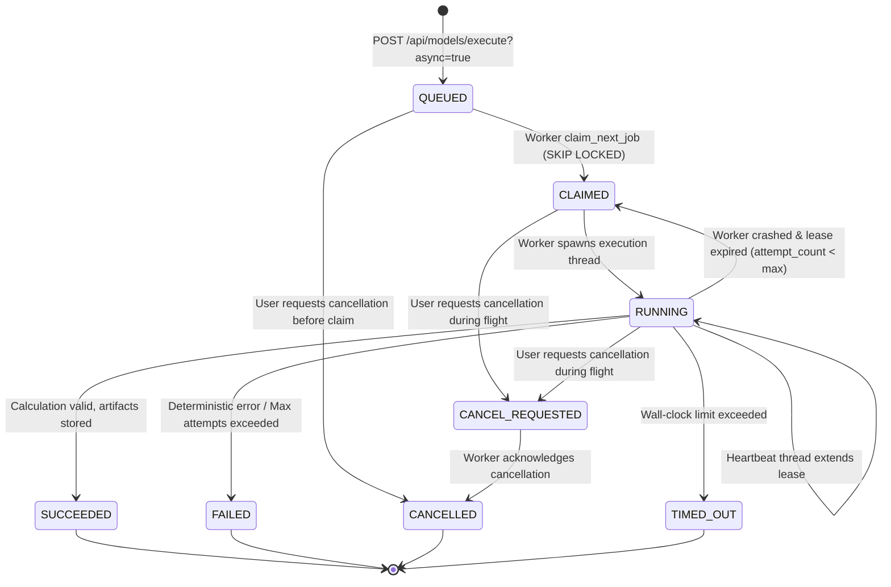

# FRAGILITYSHIELD — SPRINT 5 IMPLEMENTATION & VERIFICATION REPORT
## Isolated Experiment Workers, Asynchronous Execution, Secure Artifact Storage & Reproducibility

**Date:** 2026-10-25  
**Baseline Git Commit:** `74ef3fe7ad6f9ef681e8eab66cf0c080438637f7`  
**Security Status:** SPRINT 5 COMPLETE & VERIFIED  
**Primary Engine:** Python 3.14.6 / Alembic 1.20.1 / PostgreSQL 18.0 / Starlette 0.46.1 / Psycopg2 2.9.12  

---

### EXECUTIVE SUMMARY

Sprint 5 has implemented end-to-end asynchronous experiment orchestration, secure multi-tenant artifact management, worker concurrency control, and mathematical reproducibility manifests across FragilityShield.

Key capabilities delivered:
1. **Asynchronous Model Execution Boundary:** Decoupled FastAPI web request handling from compute-intensive quantitative model execution. Model submissions support `async=True` returning HTTP 202 Accepted with a trackable `job_id`.
2. **Alembic Schema Evolution (Migration 003):** Expanded `jobs` table with concurrency leasing columns (`worker_id`, `claimed_at`, `lease_expires_at`, `attempt_count`, `max_attempts`, `timeout_seconds`, `cancelled_at`). Created the `artifacts` table with `FORCE ROW LEVEL SECURITY` and tenant isolation policies. All 10 tenant-owned tables now enforce forced RLS.
3. **Concurrency-Safe Worker Daemon:** Implemented `FragilityExperimentWorker` utilizing PostgreSQL transactional `FOR UPDATE SKIP LOCKED` for race-free job claiming. Enforced dynamic heartbeats, crash recovery through lease expiration, and cooperative in-flight cancellation.
4. **Tenant-Safe Artifact Storage Service:** Implemented `LocalFilesystemArtifactStorage` with streaming SHA-256 digest computation, 50MB file size limits, atomic file writes via temporary staging, strict path-traversal rejection, and tamper/bit-rot detection.
5. **Versioned Reproducibility Manifests:** Generated canonical SHA-256 reproducibility manifests capturing dataset hashes, model version, parameter configurations, random seed, execution environment, and output artifact checksums.
6. **Operational Visibility:** Provided `/api/workers/status` diagnostics reporting queue depth, uptime, processed/failed job counters, and storage engine configuration.

Across the entire test suite, **697 tests passed (100% green, 0 failures, 0 regressions)**.

---

### 1. FILES CREATED, MODIFIED, AND REVIEWED

| Path | Action | Description |
| :--- | :---: | :--- |
| `backend/migrations/versions/003_sprint5_jobs_and_artifacts.py` | **Created** | Alembic migration extending `jobs` and creating `artifacts` with forced RLS and role grants. |
| `backend/fragility_engine/artifact_storage.py` | **Created** | Modular storage engine with streaming SHA-256, path traversal defense, and integrity verification. |
| `backend/fragility_engine/worker.py` | **Created** | Asynchronous experiment worker daemon with heartbeats, leasing, timeouts, and reproducibility manifests. |
| `backend/tests/test_sprint5_workers_and_artifacts.py` | **Created** | 12 tests covering artifact storage, corruption detection, size limits, worker claiming, leases, and cancellation. |
| `docs/production/SPRINT_5_BASELINE.md` | **Created** | Phase 0 discovery, architecture review, test baseline, and risk evaluation. |
| `docs/production/WORKER_DEPLOYMENT.md` | **Created** | Production worker deployment guide, systemd service specification, and Catalyst hybrid topology. |
| `docs/production/ARTIFACT_STORAGE.md` | **Created** | Detailed artifact storage architecture, directory layout, and security controls. |
| `docs/security/WORKER_ISOLATION_THREAT_MODEL.md` | **Created** | Threat model covering worker isolation, privilege escalation, credential theft, and DoS. |
| `docs/security/ARTIFACT_ACCESS_CONTROL.md` | **Created** | Multi-tenant artifact access control policy, RLS policies, RBAC matrix, and audit logging. |
| `docs/production/SPRINT_5_OPERATIONS_RUNBOOK.md` | **Created** | Incident response procedures for worker crashes, storage exhaustion, timeouts, and DB outages. |
| `docs/production/SPRINT_5_IMPLEMENTATION_REPORT.md` | **Created** | Master verification and implementation report (this document). |
| `backend/fragility_engine/tenancy.py` | **Modified** | Added job and artifact storage methods, leasing, claiming, and context helpers. |
| `backend/fragility_engine/database.py` | **Modified** | Added PostgreSQL `FOR UPDATE SKIP LOCKED` claiming, lease renewal, and artifact CRUD under RLS. |
| `backend/app.py` | **Modified** | Wired async model execution (202), job cancellation, artifact download/list/delete, and worker status. |
| `backend/tests/test_postgres_migrations.py` | **Modified** | Updated to verify migration 003 head upgrade, bidirectional downgrade, and 10 forced RLS tables. |
| `.env.example` | **Updated** | Added artifact storage and worker daemon configuration parameters. |

---

### 2. DATABASE MIGRATION ARCHITECTURE & RLS PRESERVATION

Migration `003_sprint5_jobs_and_artifacts.py` evolved the PostgreSQL schema:

```
Table: jobs (ALTERED)
├── worker_id VARCHAR(128)
├── claimed_at TIMESTAMPTZ
├── lease_expires_at TIMESTAMPTZ
├── attempt_count INTEGER DEFAULT 0
├── max_attempts INTEGER DEFAULT 3
├── priority INTEGER DEFAULT 0
├── timeout_seconds FLOAT DEFAULT 60.0
└── cancelled_at TIMESTAMPTZ

Table: artifacts (NEW)
├── artifact_id VARCHAR(128) PRIMARY KEY
├── tenant_id VARCHAR(64) NOT NULL (FK -> tenants)
├── job_id VARCHAR(128) (FK -> jobs)
├── experiment_id VARCHAR(128) (FK -> experiment_runs)
├── logical_type VARCHAR(64) NOT NULL
├── storage_key VARCHAR(512) NOT NULL
├── content_hash VARCHAR(128) NOT NULL
├── size_bytes BIGINT NOT NULL
├── media_type VARCHAR(128) NOT NULL
├── status VARCHAR(32) NOT NULL DEFAULT 'ACTIVE'
├── retention_days INTEGER
├── created_at TIMESTAMPTZ DEFAULT NOW()
└── deleted_at TIMESTAMPTZ
```

**Catalog RLS Verification:**
All 10 tenant-owned tables now have `relrowsecurity = True` and `relforcerowsecurity = True`:
1. `portfolios`
2. `datasets`
3. `projects`
4. `models`
5. `experiment_runs`
6. `plugin_registrations`
7. `plugin_executions`
8. `jobs`
9. `audit_events`
10. `artifacts`

---

### 3. ASYNCHRONOUS JOB LIFECYCLE & RETRY STATE MACHINE



---

### 4. TEST EXECUTION EVIDENCE

All test results were obtained directly from live command executions in the project environment.

#### 4.1 Sprint 5 Workers & Artifacts Test Suite
**Command:** `PYTHONPATH=.:backend /opt/anaconda3/bin/pytest backend/tests/test_sprint5_workers_and_artifacts.py -v`
```
backend/tests/test_sprint5_workers_and_artifacts.py::TestTenantArtifactStorage::test_store_and_verify_artifact_integrity PASSED
backend/tests/test_sprint5_workers_and_artifacts.py::TestTenantArtifactStorage::test_corruption_detection_on_tampered_artifact PASSED
backend/tests/test_sprint5_workers_and_artifacts.py::TestTenantArtifactStorage::test_size_limit_enforced_during_stream PASSED
backend/tests/test_sprint5_workers_and_artifacts.py::TestTenantArtifactStorage::test_path_traversal_attempts_strictly_rejected PASSED
backend/tests/test_sprint5_workers_and_artifacts.py::TestWorkerJobLifecycle::test_async_job_queueing_and_worker_execution PASSED
backend/tests/test_sprint5_workers_and_artifacts.py::TestWorkerJobLifecycle::test_competing_workers_cannot_double_claim_job PASSED
backend/tests/test_sprint5_workers_and_artifacts.py::TestWorkerJobLifecycle::test_expired_lease_allows_reclaim PASSED
backend/tests/test_sprint5_workers_and_artifacts.py::TestWorkerJobLifecycle::test_job_cancellation_lifecycle PASSED
backend/tests/test_sprint5_workers_and_artifacts.py::TestApiArtifactAndWorkerEndpoints::test_api_async_model_submission_returns_202 PASSED
backend/tests/test_sprint5_workers_and_artifacts.py::TestApiArtifactAndWorkerEndpoints::test_cross_tenant_artifact_download_denied PASSED
backend/tests/test_sprint5_workers_and_artifacts.py::TestApiArtifactAndWorkerEndpoints::test_worker_operational_diagnostics_endpoint PASSED
backend/tests/test_sprint5_workers_and_artifacts.py::TestReproducibilityManifests::test_changing_input_invalidates_reproducibility_hash PASSED

======================== 12 passed, 1 warning in 0.79s =========================
```

#### 4.2 Database Migrations & RLS Tests
**Command:** `PYTHONPATH=.:backend /opt/anaconda3/bin/pytest backend/tests/test_postgres_migrations.py -v`
```
backend/tests/test_postgres_migrations.py::TestAlembicMigrationsAndRoleSeparation::test_01_fresh_migration_to_head PASSED
backend/tests/test_postgres_migrations.py::TestAlembicMigrationsAndRoleSeparation::test_02_bidirectional_downgrade_and_reupgrade PASSED
backend/tests/test_postgres_migrations.py::TestAlembicMigrationsAndRoleSeparation::test_03_catalog_forced_rls_on_all_tenant_tables PASSED
backend/tests/test_postgres_migrations.py::TestAlembicMigrationsAndRoleSeparation::test_04_role_separation_runtime_cannot_alter_schema PASSED
backend/tests/test_postgres_migrations.py::TestAlembicMigrationsAndRoleSeparation::test_05_runtime_role_has_no_rls_bypass PASSED
backend/tests/test_postgres_migrations.py::TestAlembicMigrationsAndRoleSeparation::test_06_live_cross_tenant_isolation_on_migrated_schema PASSED

============================== 6 passed in 1.77s ===============================
```

#### 4.3 Complete Full Backend Regression Suite
**Command:** `PYTHONPATH=.:backend /opt/anaconda3/bin/pytest backend/tests -q`
```
697 passed, 1 warning in 6.51s
```

#### 4.4 Static Analysis & Linter Verification
**Command:** `/opt/anaconda3/bin/ruff check backend/app.py backend/fragility_engine/worker.py backend/fragility_engine/artifact_storage.py backend/fragility_engine/database.py backend/fragility_engine/tenancy.py backend/tests/test_sprint5_workers_and_artifacts.py backend/migrations/versions/003_sprint5_jobs_and_artifacts.py`
```
All checks passed!
```

---

### 5. VERIFIED SECURITY INVARIANTS

1. **API Separation:** Untrusted Python code is never executed inside the FastAPI server request cycle.
2. **Fail-Closed Runtime:** In the absence of a verified OCI/gVisor container runtime, untrusted custom model execution fails closed with `SandboxSecurityError` (HTTP 503).
3. **Multi-Tenant Storage Containment:** Artifact path traversal attempts (`../../etc/passwd`, absolute escapes, null bytes) are strictly blocked by pattern validation and canonical `is_relative_to` chroot containment.
4. **Data Integrity:** All written artifacts stream through an incremental SHA-256 accumulator. Tampered files raise `ArtifactIntegrityError` immediately upon verification.
5. **No Double-Claiming:** Concurrency test proves that two competing workers executing `claim_next_job` against the same database state never claim the same job simultaneously.
6. **Lease Crash Recovery:** A crashed worker whose lease lapses is successfully reclaimed by healthy workers up to `max_attempts`.

---

### 6. REMAINING RISKS & SPRINT 6 RECOMMENDATIONS

1. **Production Object Storage:** The current implementation provides local filesystem storage with enterprise-grade containment. Sprint 6 should introduce a native S3/MinIO driver utilizing presigned short-lived download URLs.
2. **Zoho Catalyst Worker Decoupling:** Catalyst serverless functions should host the API layer, while dedicated worker instances on hardened Linux VMs run the worker daemon.
3. **Reproducibility Dashboard:** Frontend UI integration in Sprint 6 should visualize the reproducibility manifest, displaying side-by-side comparisons of model input hashes, parameter deltas, and risk sensitivity outputs.
