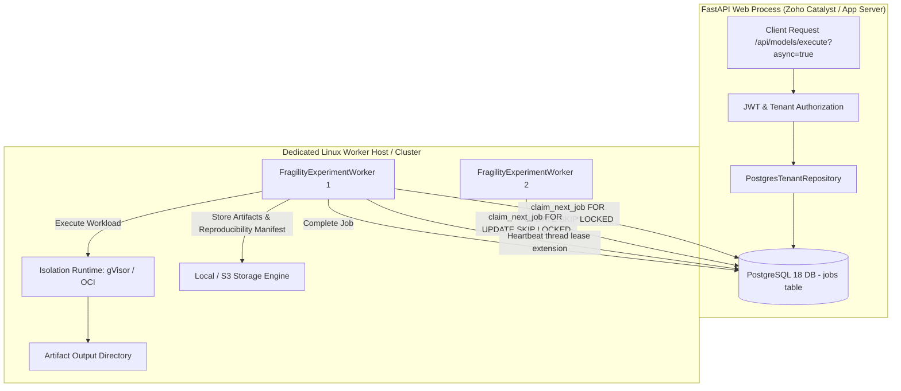

# FragilityShield — Worker Deployment & Operational Architecture

## 1. System Overview

FragilityShield decouples user-facing HTTP request handling from compute-intensive, assumption-aware financial experiment execution. The API layer provides authentication, tenant validation, rate limiting, and job submission, while background worker daemons claim, isolate, execute, and record quantitative experiments.



---

## 2. Worker Core Capabilities & Lifecycle

The worker daemon (`backend/fragility_engine/worker.py`) implements:
1. **Concurrency-Safe Claiming:** Uses PostgreSQL transactional `FOR UPDATE SKIP LOCKED` on eligible `QUEUED` jobs. Multiple workers never double-claim the same job.
2. **Lease Management & Crash Recovery:** Each claim establishes a dynamic lease (default 30 seconds). An asynchronous background heartbeat extends `lease_expires_at` as long as execution continues. If a worker process terminates abruptly (OOM, segfault, hardware failure), the lease expires, allowing other workers to safely reclaim the job up to `max_attempts` (default: 3).
3. **Cancellation Enforcement:** Periodic cooperative cancellation checks during execution. If a user triggers `POST /api/models/jobs/{id}/cancel`, in-flight jobs transition to `CANCEL_REQUESTED`, allowing the worker runtime to cleanly terminate execution and mark the job `CANCELLED`.
4. **Reproducibility Manifesting:** Upon completion, the worker writes a canonical SHA-256 reproducibility manifest capturing input hashes, model version, execution parameters, random seed, runtime environment, and output artifact hashes.

---

## 3. Worker Configuration Parameters

Workers are configured via environment variables or a direct `WorkerConfig` instance:

| Variable | Default | Purpose |
| :--- | :--- | :--- |
| `WORKER_ID` | `worker_node_01` | Unique hostname or process identifier for operational tracing. |
| `WORKER_POLL_INTERVAL_SECONDS` | `1.0` | Sleep interval between empty queue polls. |
| `WORKER_LEASE_DURATION_SECONDS` | `30.0` | Duration of active lease granted on claim. |
| `WORKER_MAX_CONCURRENT_JOBS` | `1` | Max simultaneous jobs per worker thread. |
| `WORKER_MAX_ATTEMPTS` | `3` | Maximum retry attempts before permanent job failure. |
| `WORKER_DEFAULT_TIMEOUT_SECONDS` | `60.0` | Maximum wall-clock execution limit per job. |
| `DATABASE_URL` | None | PostgreSQL connection URL with `fragility_app_user` credentials. |
| `ARTIFACT_STORAGE_PATH` | `./data/artifacts` | Base directory for experiment artifact storage. |

---

## 4. Production Deployment: Systemd Service Unit

On dedicated worker Linux nodes (e.g. Ubuntu 22.04 LTS / Debian 12), deploy the worker as a systemd service:

Create `/etc/systemd/system/fragilityshield-worker@.service`:

```ini
[Unit]
Description=FragilityShield Experiment Worker Instance %i
After=network.target postgresql.service
Wants=network-online.target

[Service]
Type=simple
User=fragility_worker
Group=fragility_worker
WorkingDirectory=/opt/fragilityshield
EnvironmentFile=/etc/fragilityshield/worker.env
ExecStart=/opt/fragilityshield/venv/bin/python -m fragility_engine.worker --worker-id worker-%H-%i
Restart=on-failure
RestartSec=5s
KillMode=mixed
TimeoutStopSec=45s

# Security and Sandboxing Directives
ProtectSystem=strict
ProtectHome=true
PrivateTmp=true
ReadWritePaths=/opt/fragilityshield/data/artifacts /var/log/fragilityshield
NoNewPrivileges=true
CapabilityBoundingSet=

[Install]
WantedBy=multi-user.target
```

To enable and run multiple concurrent worker instances:
```bash
sudo systemctl daemon-reload
sudo systemctl enable --now fragilityshield-worker@1.service
sudo systemctl enable --now fragilityshield-worker@2.service
sudo systemctl status fragilityshield-worker@*.service
```

---

## 5. Zoho Catalyst Compatibility & Hybrid Architecture

**Catalyst Runtime Constraints:**
- Zoho Catalyst Serverless Functions enforce a 15-minute execution limit and read-only filesystem (except `/tmp`).
- Catalyst does not support privileged Docker sockets or native gVisor/Kata container execution.

**Recommended Hybrid Topology:**
1. **API Service:** Hosted on Zoho Catalyst AppSail (or Serverless Functions) with standard HTTP routing.
2. **Database:** PostgreSQL 18 managed cluster with forced Row-Level Security (RLS).
3. **Worker Nodes:** Deployed on dedicated hardened Linux instances (AWS EC2 / Hetzner / GCP Compute Engine) running the systemd service above.
4. **Communication:** Entirely asynchronous via the shared PostgreSQL jobs table and shared object storage (S3 / MinIO). The worker nodes never expose inbound HTTP ports to the public internet, eliminating ingress attack vectors.
