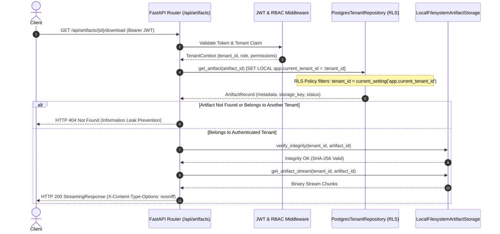

# FragilityShield — Artifact Access Control & Permissions Policy

## 1. Access Control Philosophy

Experiment artifacts are financial research property belonging exclusively to the tenant that produced them. FragilityShield mandates that no artifact may be read, listed, downloaded, or deleted without passing cryptographic authentication, RBAC authorization, and database Row-Level Security.

---

## 2. Multi-Layer Access Control Pipeline



---

## 3. Database Row-Level Security (RLS) Policies

The `artifacts` table was introduced in migration `003_sprint5_jobs_and_artifacts.py` with forced RLS:

```sql
ALTER TABLE artifacts ENABLE ROW LEVEL SECURITY;
ALTER TABLE artifacts FORCE ROW LEVEL SECURITY;

CREATE POLICY tenant_isolation_artifacts ON artifacts
    FOR ALL
    TO fragility_app_user
    USING (tenant_id = current_setting('app.current_tenant_id', true))
    WITH CHECK (tenant_id = current_setting('app.current_tenant_id', true));
```

### Security Invariants:
1. Even if the application developer fails to include `WHERE tenant_id = :tenant_id` in a raw SQL query, the PostgreSQL query planner injects the filter automatically.
2. Even table owners or runtime roles cannot bypass RLS because `FORCE ROW LEVEL SECURITY` applies to the table owner as well, and `fragility_app_user` has `NOBYPASSRLS`.
3. If `app.current_tenant_id` is missing or empty, the query yields zero rows.

---

## 4. Role-Based Permissions (RBAC)

Within a tenant, artifact operations are governed by `TenantRole`:

| Operation | Required Role | Justification |
| :--- | :--- | :--- |
| `GET /api/artifacts` (List) | `VIEWER`, `RESEARCHER`, `RISK_MANAGER`, `ADMIN` | Read-only visibility into completed experiment outputs. |
| `GET /api/artifacts/{id}/download` | `RESEARCHER`, `RISK_MANAGER`, `ADMIN` | Downloading raw binaries requires researcher credentials. |
| `GET /api/artifacts/{id}/metadata` | `VIEWER`, `RESEARCHER`, `RISK_MANAGER`, `ADMIN` | Inspecting SHA-256 hash, size, and creation date. |
| `DELETE /api/artifacts/{id}` | `ADMIN` | Deletion of compliance/experiment evidence is restricted to administrators. |

---

## 5. Deletion & Retention Invariants

1. **Active Reference Protection:** Artifacts referenced by an active experiment reproducibility manifest cannot be hard-deleted until the retention period expires.
2. **Soft Deletion & Tombstoning:** When deleted, `artifacts.status` is set to `'DELETED'` and an audit event (`ARTIFACT_DELETED`) is immutably appended to `audit_events`.
3. **Physical File Removal:** Local binary and metadata files are unlinked only after the database record update succeeds.
