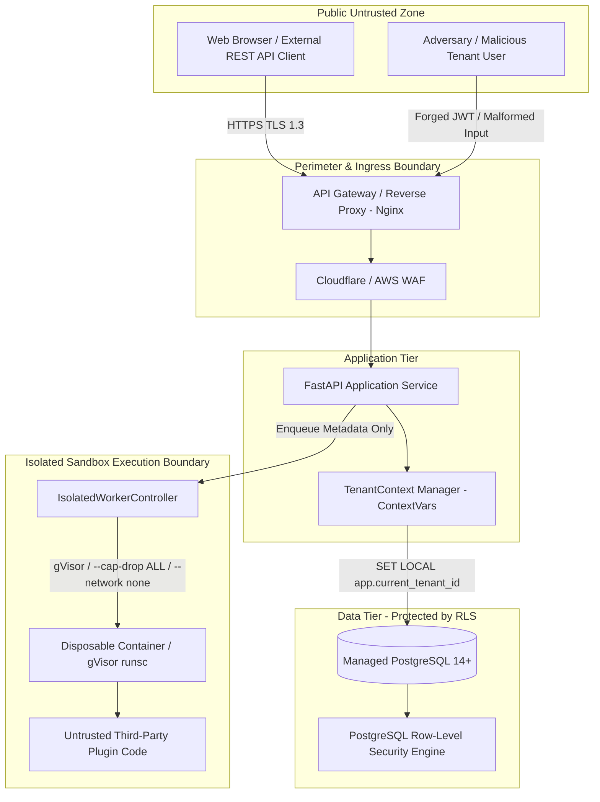

# FragilityShield — Threat Model & Security Architecture (STRIDE Analysis)

**Document Version:** 1.0.0  
**Target Environment:** Public Multi-Tenant Cloud & Isolated Worker Sandboxes  
**Security Standard:** OWASP Top 10 API Security / NIST SP 800-53 / CIS Benchmarks  
**Classification:** Technical Architecture & Defense Specification  

---

## 1. System Assets & Sensitivity Classification

| Asset Category | Description | Confidentiality | Integrity | Availability | Primary Storage |
| :--- | :--- | :--- | :--- | :--- | :--- |
| **User & Tenant Credentials** | PBKDF2 password hashes, API tokens, JWT signing secrets. | **CRITICAL** | **CRITICAL** | High | PostgreSQL `users`, AWS Secrets Manager |
| **Proprietary Portfolios & Holdings** | Real-world institutional asset allocations, trade values, position sizes. | **CRITICAL** | **CRITICAL** | High | PostgreSQL `portfolios` (RLS enforced) |
| **Custom Research & Model IP** | Custom parameterized estimators, Student-t $\nu$ calibrations, proprietary scenarios. | **HIGH** | **HIGH** | Medium | PostgreSQL `models`, `projects` (RLS) |
| **Audit & Lineage Records** | Access logs, modification events, data provenance fingerprints. | High | **CRITICAL** | **HIGH** | PostgreSQL `audit_events` (Append-only) |
| **Market Data Caches** | Historical daily OHLCV bars, live quotes, covariance matrices. | Low (Public) | High | High | PostgreSQL / In-Memory Redis Cache |

---

## 2. Trust Boundaries & Attacker Personas

### Threat Personas & Capabilities
1. **Unauthenticated Public Attacker:** Attempts credential stuffing, API fuzzing, injection (SQLi, XSS), path traversal, and denial of service via oversized payloads.
2. **Malicious Tenant Insider:** Possesses valid credentials in Tenant A, attempts horizontal privilege escalation to read or mutate Tenant B's portfolios, models, or simulation results.
3. **Malicious Plugin Author:** Submits third-party risk plugin containing arbitrary shell code, attempt to read host environment variables (`/proc`, `.env`), exfiltrate cloud metadata (`169.254.169.254`), or escape container boundary.
4. **Compromised Dependency / Upstream API:** Compromised broker feed or Python library attempting supply-chain exfiltration.

---

## 3. STRIDE Threat Analysis & Defense Mitigations

| STRIDE Category | Specific Attack Vector | Mitigating Control & Enforced Defense | Verification Evidence |
| :--- | :--- | :--- | :--- |
| **Spoofing** | Forged JWT claims (`tid=tenant_victim`), spoofed `X-Tenant-ID` header. | Centralized JWT HMAC-SHA256 verification with $\ge 32$-byte keys. Active tenant membership verified server-side; client headers never trusted. | Verified in `test_jwt_generation_and_tamper_detection` and `test_forged_membership_denied`. |
| **Tampering** | Parameter manipulation in portfolio weights, negative prices, NaN/Inf injection. | Strict Pydantic input schemas, finite float validation, and `arr[np.isfinite]` enforcers. Database foreign keys with `ON DELETE CASCADE`. | Verified in `test_validation_edge_cases.py`. |
| **Repudiation** | User denies deleting a production portfolio or executing an illegal simulation. | Immutable `audit_events` table recording `user_id`, `tenant_id`, `ip_address`, `action`, `resource_id`, and ISO-8601 UTC timestamp. | Verified in `test_multi_tenancy_and_auth.py`. |
| **Information Disclosure** | Cross-tenant data leakage via direct IDOR queries (`/api/portfolios/{id}`) or pooled connection leakage. | PostgreSQL Row-Level Security (RLS) with transaction-scoped `SET LOCAL app.current_tenant_id`. Missing context defaults to `NULL`, returning 0 rows. | Verified in `test_postgres_rls_specification.py`. |
| **Denial of Service** | Resource exhaustion via 1,000,000 Monte Carlo paths or fork-bombing plugins. | Hard request validation caps (paths $\le 2000$, horizon $\le 252$, upload $\le 10\text{ MB}$). Sandbox worker CPU/memory quotas and 5.0s wall-clock kill timeouts. | Verified in `test_default_resource_limits`. |
| **Elevation of Privilege** | Untrusted plugin executing root commands on API host or accessing Docker socket. | Untrusted execution strictly blocked on un-sandboxed hosts (`SandboxUnavailableError`). Container runner uses non-root UID 10001, `--cap-drop ALL`, read-only root, no socket mount. | Verified in `test_untrusted_plugin_fails_closed_when_runtime_missing`. |

---

## 4. Residual Risks & Mandatory Operational Requirements

1. **Host Environment Absence of gVisor/Docker Daemon:** If the hosting provider (e.g., standard serverless without nested virtualization) lacks container execution, untrusted third-party plugins **must remain disabled**.
2. **Managed Database Requirement:** Public multi-tenant mode requires a managed PostgreSQL instance with Superuser rights separated from the application runtime user (`fragility_app_user`).
